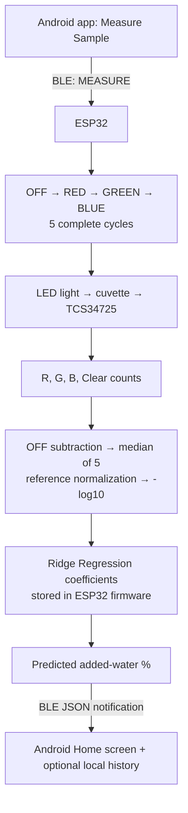
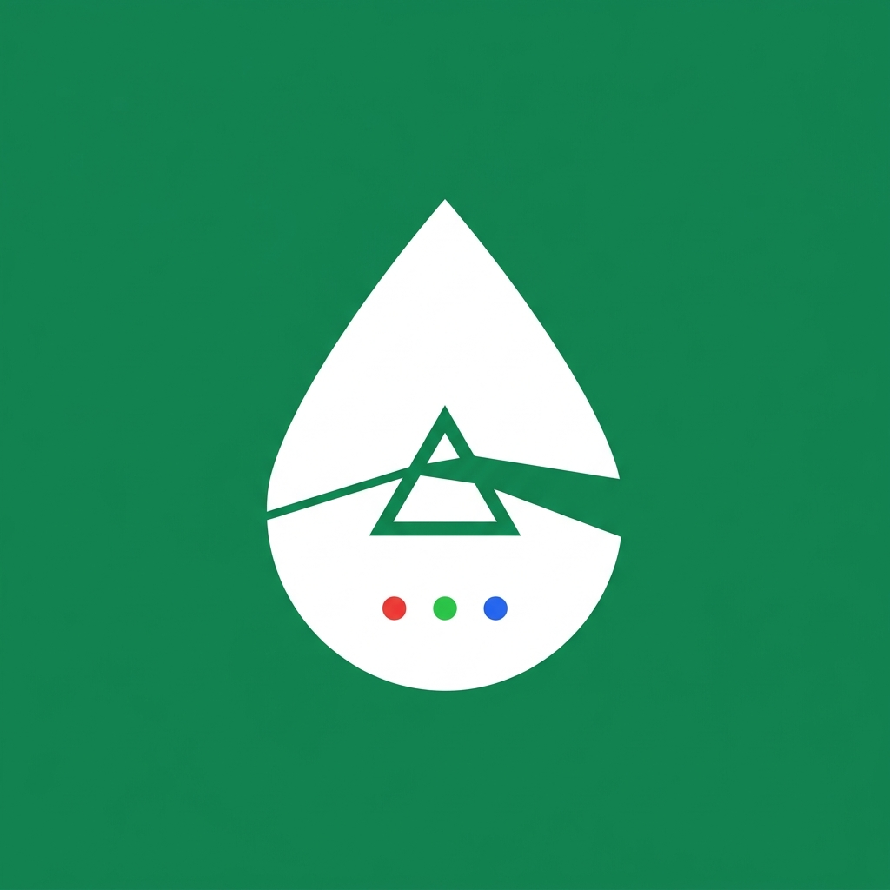

<div align="center">


# OptiMilk-AI
**Portable ESP32 Optical Milk–Water Estimation • TCS34725 • Ridge Regression • Android BLE**

### [⬇️ Download & Install the Android APK](https://raw.githubusercontent.com/shanmukhdatta/OptiMilk-AI/main/app/OptiMilk-AI-debug.apk)

[Android source](app/) · [Raw-format CSV](data/raw/01_RAW_0_to_100_5_repeats.csv) · [Augmented CSV](data/raw/02_AUGMENTED_0_to_100_500_cycles.csv) · [Training script](ml/train_kaggle.py)

</div>

> **Project status:** A functioning ESP32 sensor + on-device regression **demonstration**. The concentration-labelled CSVs below are **synthetic dummy milk-water data** for developing the ML pipeline. They are *not measured milk-dilution experiments* and cannot establish real-world adulteration accuracy.

## 1. How the instrument works

The project uses an ESP32, three external visible LEDs (red, green and blue), a cuvette, and a **TCS34725 RGB/Clear sensor**. LEDs illuminate **one at a time**; the sensor returns four digital counts for each LED state: **R, G, B and Clear**.



<div align="center">

</div>

**Hardware mapping (existing prototype):**

| Component | Connection / setting |
| --- | --- |
| Red LED | GPIO **25**, with its own current-limiting resistor |
| Green LED | GPIO **26**, with its own current-limiting resistor |
| Blue LED | GPIO **27**, with its own current-limiting resistor |
| TCS34725 SDA / SCL | GPIO **21 / 22** |
| TCS34725 | **50 ms integration, 16× gain** in the current sketch |
| Measurement | **5 cycles**, switching each LED separately |

**What the readings mean:** R/G/B are color-filtered photodiode counts; Clear is the broad visible-light count. We store all four raw channels, but the initial inference pipeline uses **Clear under each separately illuminated LED**. This is an apparent optical attenuation method: because milk scatters light, Beer–Lambert absorbance is **not a direct analytical formula for water percentage**.

## 2. Final datasets

Exactly **two** CSV datasets are kept in `data/raw/`. Here **raw** means unprocessed R/G/B/Clear-style records; *it does not mean that the concentration-labelled rows were physically measured*.

| Final CSV | Rows | Complete LED cycles | Simulated profiles | Contents |
| --- | ---: | ---: | ---: | --- |
| [01_RAW_0_to_100_5_repeats.csv](data/raw/01_RAW_0_to_100_5_repeats.csv) | **220** | **55** | **11** | One sample at each 0, 10, …, 100% water level; **5 repeats each** |
| [02_AUGMENTED_0_to_100_500_cycles.csv](data/raw/02_AUGMENTED_0_to_100_500_cycles.csv) | **2,000** | **500** | **100** | The same base rows plus additional varied simulated sample profiles |

Both files contain **only** the eight agreed columns, in this order:

```csv
sample_no,repeat,LED,R,G,B,Clear,water_pct
W000_S01,1,OFF,0,0,0,0,0
W000_S01,1,RED,98,10,12,107,0
```

Each `(sample_no, repeat)` has **four rows**: OFF, RED, GREEN, BLUE. Five repeats belong to the same simulated profile. Example: **11 levels × 5 repeats × 4 states = 220 rows**. The augmented file has **500 distinct cycles × 4 states = 2,000 rows**. Water percentages run from **0% to 100% in steps of 10%**.

## 3. How synthetic augmentation was made

Source: [`ml/augment_dataset.py`](ml/augment_dataset.py). This script reproducibly regenerates **the exact two CSV files** using a fixed random seed (`20261118`).

The simulation uses **seven relatively stable water-filled-cuvette readings supplied from the real ESP32 sensor** to estimate a water reference and correlated signal fluctuations.

1. **Water-only reference:** Clear channel medians were approximately RED **288**, GREEN **9106**, BLUE **1603**. These are reference counts, not milk measurements.
2. **Assumed dilution curve:** For a demonstration, calculate apparent attenuation `A(w) = A_milk × (1 − w/100)^p` and synthetic intensity `I(w) = I_water × 10^(-A(w))`. Pure-milk parameters are **hypothetical**.
3. **Correlated residual resampling:** Resample measured 12-channel (three LEDs × four sensor channels) water-cycle fluctuation patterns together, preserving inter-channel relationships.
4. **Additional variation:** Add small Gaussian, per-sample and per-cycle perturbations; round and constrain counts to the sensor range.
5. **Sanity checks:** Verify every four-state cycle, concentration label, row count and that the 500 cycles have different multi-channel signatures.

This is **more than independently adding random noise**, but the assumed dilution curve is not validated. A model trained on these files learns the **simulator's** relationship, not necessarily the behavior of actual milk.

### Regenerate both files

```bash
pip install numpy
python ml/augment_dataset.py
```

## 4. Train the model in Kaggle or Python

Use [`ml/train_kaggle.py`](ml/train_kaggle.py) (commented source, Kaggle-compatible). It is the single training script: no separate dataset transformations are needed in the repository.

1. Open [Kaggle Code](https://www.kaggle.com/code) and create a notebook.
2. **Add Input** → upload [the augmented CSV](data/raw/02_AUGMENTED_0_to_100_500_cycles.csv).
3. Copy the contents of `ml/train_kaggle.py` into a Kaggle code cell and run, **or** upload the `.py` and run it.
4. The script finds the CSV, forms complete LED cycles, subtracts OFF, takes a five-repeat **median**, normalizes using LED-specific pure-water Clear references and calculates three apparent absorbances.
5. It compares **Linear Regression** and **Ridge Regression** on a simulated held-out split, refits Ridge and exports `model_parameters.h`.

```bash
# Local alternative from the repository root:
pip install numpy pandas scikit-learn
python ml/train_kaggle.py --output model_parameters.h
```

The exported tiny embedded model is:

```text
Water% = REG_INTERCEPT + REG_RED*A_RED + REG_GREEN*A_GREEN + REG_BLUE*A_BLUE
```

**Reproducible demonstration coefficients** on the supplied augmented CSV:

| Parameter | Value |
| --- | ---: |
| `REG_INTERCEPT` | **96.996608** |
| `REG_RED` | **−18.439649** |
| `REG_GREEN` | **−51.507125** |
| `REG_BLUE` | **−71.605867** |

The script uses `REG_*` names to avoid Arduino's existing `B0` and `B1` constants. These are **linear Ridge Regression coefficients**, not a trained polynomial regression model. Train and export a different model if switching to degree-two polynomial features. Synthetic test scores must never be presented as experimentally validated milk accuracy.

## 5. ESP32 inference and Android app

Training happens on Kaggle/laptop; **inference happens on ESP32** using the small coefficient equation. The Android app displays the returned result over BLE.

The existing Android app source is in [`app/`](app/), with its [own setup guide](app/README.md). The BLE protocol already implemented by the app is **Nordic UART Service (NUS)**:

| Interface | Value |
| --- | --- |
| Service UUID | `6E400001-B5A3-F393-E0A9-E50E24DCCA9E` |
| Phone → ESP32 (RX) | `6E400002-B5A3-F393-E0A9-E50E24DCCA9E` |
| ESP32 → Phone (TX notifications) | `6E400003-B5A3-F393-E0A9-E50E24DCCA9E` |
| Measure command | `MEASURE\n` |
| Optional calibrate command | `CALIBRATE\n` |

Expected measurement JSON (illustrative, not an actual milk test):

```json
{"type":"result","r":630,"g":1301,"b":1311,"c":2349,"concentration":60.36,"unit":"%","status":"ok"}
```

The current APK's four R/G/B/Clear cards show a **representative channel reading** returned by firmware; it does not yet expose all five cycles or all 12 LED-specific readings. The UI can be extended later. **Pairing in Android Bluetooth Settings is not the same as an active in-app BLE GATT connection.** Connect using the app's **Connect ESP32** screen.

For the initial software demonstration, the ESP32 may use stored pure-water reference counts. Those values must correspond to the **same gain (16×), LED current, cuvette positioning and optical setup** as the current sensor readings. A fresh blank calibration is needed for trustworthy physical measurements.

## 6. Install OptiMilk-AI on Android

### [📲 Tap here to download the OptiMilk-AI debug APK](https://raw.githubusercontent.com/shanmukhdatta/OptiMilk-AI/main/app/OptiMilk-AI-debug.apk)

1. Download the file onto your Android phone.
2. Open the downloaded `.apk` and allow **Install unknown apps** for the browser/file manager if Android requests it.
3. Turn on Bluetooth, open OptiMilk-AI and grant nearby-device permissions.
4. Power the ESP32 (with BLE firmware), choose **Connect ESP32**, then **Measure Sample**.

The APK is a **debug build** for this prototype; it is not distributed through the Play Store. Source and local build instructions: [Android app README](app/README.md). Android Studio / JDK 17 can build with `gradle :app:assembleDebug`; GitHub Actions also builds the APK.

---

### Project limitations

- **These two concentration-labelled datasets are synthetic.** No physical 0–100% milk-dilution dataset was collected for them.
- The experimentally observed ESP32 serial regression result establishes that the computation **runs**, not that its water-percentage estimate is scientifically accurate.
- Optical scattering, temperature, milk batch, cuvette geometry, reference drift and sensor saturation affect real readings.
- Before presenting real analytical accuracy, collect independently prepared, concentration-labelled physical milk mixtures and evaluate the trained model on unseen real batches.

**Repository:** [shanmukhdatta/OptiMilk-AI](https://github.com/shanmukhdatta/OptiMilk-AI) · **Android:** [app/README.md](app/README.md)
